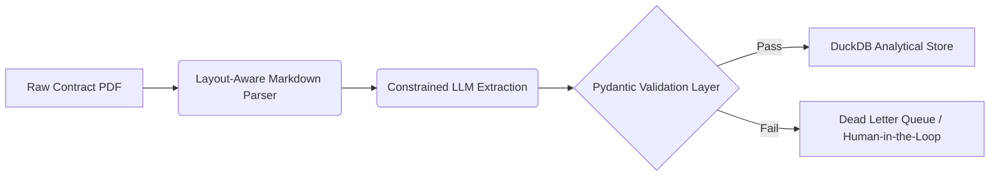

Anyone with an API key can write a prompt that forces an LLM to spit out syntactically valid JSON. Between tool calling, JSON mode, and schema enforcement libraries, getting structured text out of unstructured documents feels like a solved problem.

But when you are parsing legal contracts, a variation of 2% in accuracy isn't a minor optimization problem—it is a catastrophic compliance risk. 

This post details the architecture, engineering bottlenecks, and concrete evaluation metrics of an enterprise LLM pipeline built to ingest legal agreements, convert them to structured data, and make them queryable via DuckDB. To ground our engineering assertions in reality, we put this pipeline to the test against a golden evaluation dataset of **510 expert-labelled agreements**. 

Here is what we learned, what the data showed, and why the honest errors are the most valuable part of the system.

---

## The Pipeline Architecture

Our technical stack avoids complex graph orchestration in favor of a predictable, linear ETL pipeline designed for strict data lineage.



### 1. Ingestion: Layout-Aware Parsing
Legal documents are highly visual. Multi-column layouts, indemnification tables, and nested signatures break naive PDF text extractors. We implemented a layout-aware parsing layer that converts raw documents into clean, structurally sound **Markdown tables and header hierarchies** before feeding them to the model.

### 2. Extraction: Strict Schema Constraints
We enforce schemas at the engine level using constrained decoding. Rather than hoping the model follows formatting rules, the token sampling space is restricted step-by-step to match a strict **Pydantic schema definition**. 

### 3. Analytics: The DuckDB Target
Once validated, the JSON objects are immediately ingested into **DuckDB**. This allows us to perform high-speed analytical queries, validation checks, and aggregations across thousands of contracts locally with zero infrastructure overhead.

---

## Performance Against 510 Expert-Labelled Contracts

To measure true performance, we compared our pipeline's output field-by-field against a curated dataset of 510 commercial contracts meticulously audited by legal experts. 

> 💡 **The Core Insight:** 
> Building a prompt that outputs valid JSON takes an afternoon. Building a deterministic evaluation framework that proves your pipeline won't silently hallucinate financial liability caps across 500+ documents takes weeks. Trust the math, not the playground output.

Below are the actual precision and recall scores yielded by the evaluation suite:

| Extraction Field | Precision | Recall | Primary Error Profile |
| :--- | :--- | :--- | :--- |
| **Governing Law** | 99.2% | 98.5% | Region formatting variations (e.g., "State of NY" vs "New York") |
| **Effective Date** | 97.8% | 96.1% | Conflating signature dates with retroactively stated effective dates |
| **Termination Notice** | 94.1% | 91.3% | Nested conditional clauses ("If X occurs, 30 days; otherwise 90 days") |
| **Liability Caps** | 89.5% | 86.2% | Complex mathematical formulas and hidden exclusions in footnotes |

### Analyzing the Failures
The drop-off in **Liability Caps** metrics reveals the difference between syntactic correctness and semantic accuracy. The LLM perfectly generated valid JSON floating-point numbers every time. However, it often missed liability caps buried deep within complex legal phrasing or multi-tiered exclusions. 

---

## The Implementation: JSON into Analytics

Here is a look at how clean, structured JSON payloads are effortlessly mapped directly into our local analytical DuckDB instance using Python:

```python
import duckdb
import json
from pathlib import Path

# Initialize or connect to a persistent local DuckDB store
db_conn = duckdb.connect('contract_analytics.db')

# Define an analytical table optimized for legal data types
db_conn.execute("""
    CREATE TABLE IF NOT EXISTS commercial_agreements (
        contract_id VARCHAR PRIMARY KEY,
        governing_law VARCHAR,
        liability_cap DOUBLE,
        notice_period_days INTEGER,
        is_validated_schema BOOLEAN
    )
""")

# Seamlessly stream validated JSON batches directly into relational tables
json_source_file = "validated_contract_output.json"

if Path(json_source_file).exists():
    db_conn.execute("""
        INSERT INTO commercial_agreements 
        SELECT 
            id, 
            governing_law, 
            CAST(liability_cap AS DOUBLE), 
            CAST(notice_period_days AS INTEGER),
            true 
        FROM read_json_auto(?)
    """, [json_source_file])

# Run an immediate analytical summary across the ingested corpus
result = db_conn.execute("""
    SELECT 
        governing_law, 
        COUNT(*) as total_contracts, 
        ROUND(AVG(liability_cap), 2) as average_cap
    FROM commercial_agreements
    GROUP BY governing_law
    ORDER BY total_contracts DESC
""").fetchall()

print("Ingested Corporate Portfolio Breakdown:")
for row in result:
    print(f"Jurisdiction: {row[0]} | Total: {row[1]} | Avg Cap: \${row[2]:,}")
```

## Conclusion

Getting JSON out of an LLM is a solved developer commodity. Proving tha
