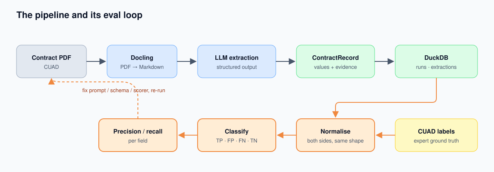
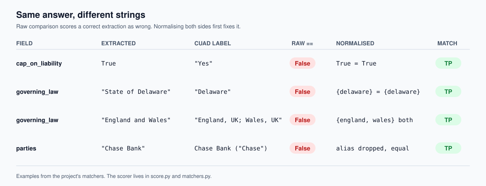

<!-- TODO(Santosh): replace this paragraph with your real hook. I don't have the story behind "0 out of 6", so I haven't invented one. -->

When I first wired up the scorer for my contract-extraction pipeline, the numbers looked terrible. The extractor was returning the right answers. The scorer just couldn't tell.



## Same answer, different strings

The extractor returns typed values. The ground truth, the expert-labelled [CUAD](https://www.atticusprojectai.org/cuad) set, returns whatever a human typed into a spreadsheet. Compare them raw and a correct answer scores as wrong:



Every field in the scorer now goes through the same three steps:

1. **Normalise** both sides to the same shape.
2. **Decide absence** with one rule (`None`, `False`, empty, `NaN` all mean "not in the contract").
3. **Classify** as TP / FP / FN / TN.

```python
resp = client.responses.parse(model=MODEL, input=msgs, text_format=ContractRecord)
```

## Rules that came out of the failures

- **A wrong value is both a false positive and a false negative.** If the model says `Illinois` and the label says `Illinois; New York`, it found something and also missed something.
- **Partial dates never match.** The label `03/[]/1999` stays a string, so it is "present" but can never equal an invented full date like `1999-03-01`.
- **Booleans raise on surprises.** An unexpected label raises an error instead of quietly becoming `False`.
- **Never split party names on commas.** `Chase Bank USA, N.A.` is one party.
- **The harness checks itself.** It asserts that outcomes cover every scored contract and lists skipped files rather than hiding them.

## The numbers, once the scorer was trustworthy

| Field | Precision | Recall | Support |
|---|---:|---:|---:|
| agreement_date | 0.90 | 0.95 | 19 |
| governing_law | 0.95 | 0.95 | 19 |
| cap_on_liability | 1.00 | 0.22 | 18 |
| non_compete | 0.80 | 0.33 | 12 |
| parties (per party) | 0.98 | 0.48 | 91 |
| renewal_term | 0.08 | 0.09 | 11 |

::: {.callout-note}
A wrong value counts as both a false positive and a false negative.
:::

Twenty contracts is a small sample, so treat this as directional. Code and full failure list: [mediansant/doc-intel](https://github.com/mediansant/doc-intel).
